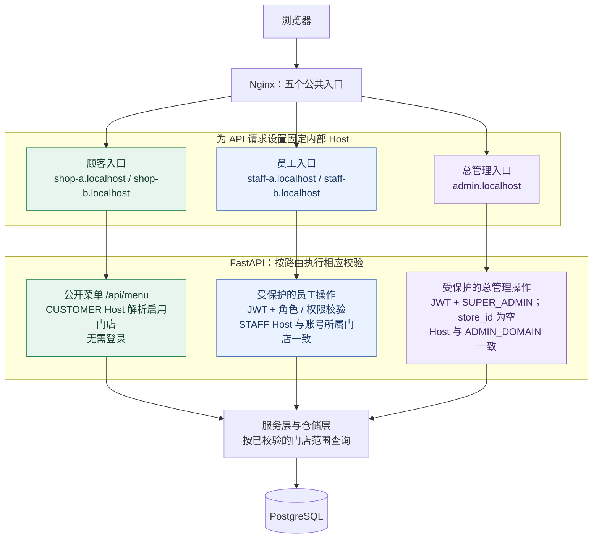
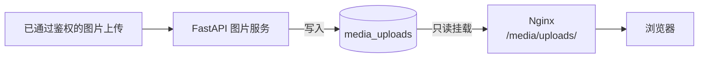
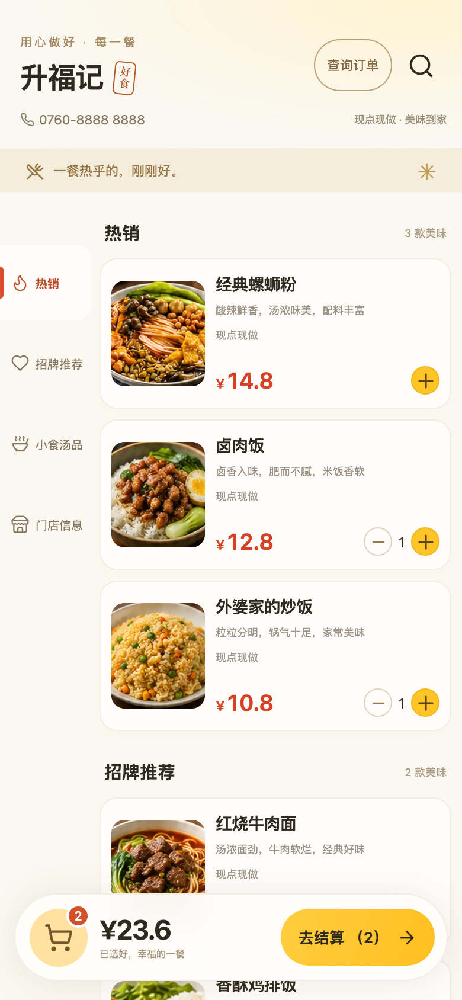
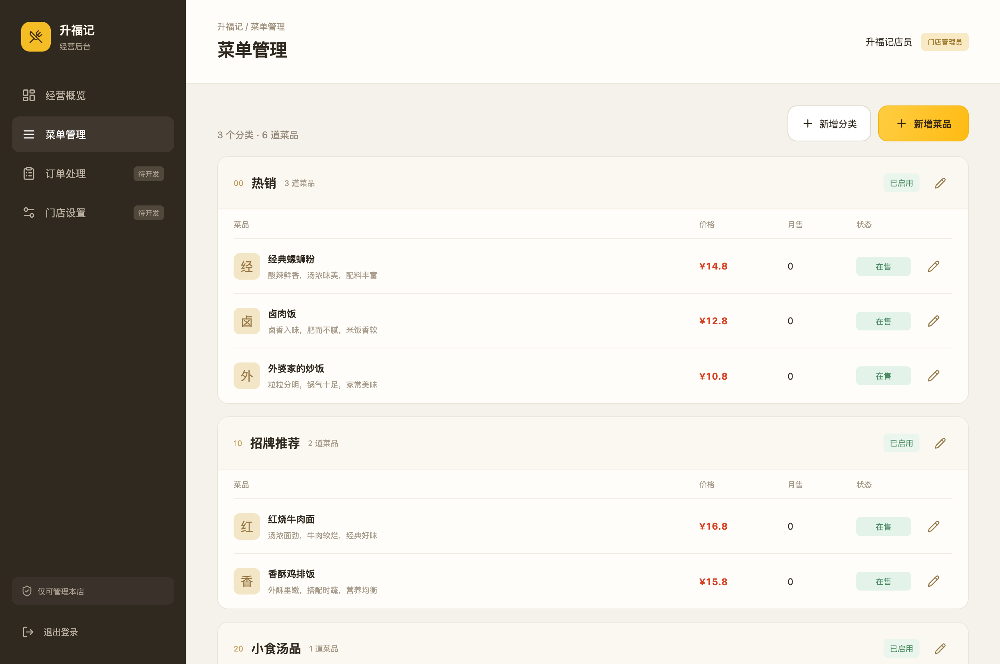
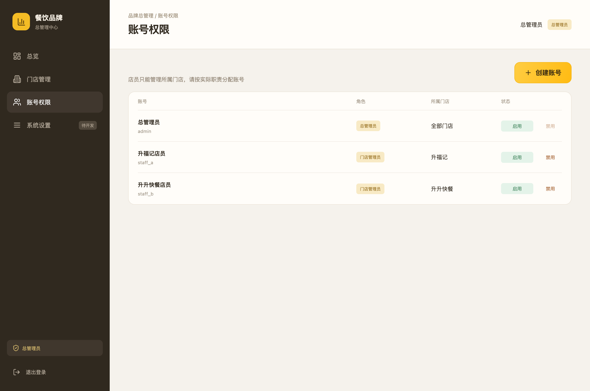

# 双门店点餐系统

[English documentation](README.md) · [部署指南](docs/DEPLOYMENT.zh-CN.md) · [English deployment guide](docs/DEPLOYMENT.md)

这是一个面向两家门店的点餐和运营系统。两家门店共用一套 FastAPI 服务、PostgreSQL 数据库和 Nginx 部署，但菜单、员工账号、会员、配送配置和交易记录都按门店范围隔离。

仓库包含三套 Vue 应用：顾客点餐端、门店员工后台，以及可以切换两家门店的总管理后台。当前代码已经实现菜单管理、会员账号、地址簿、配送费计算、订单状态流转、库存和优惠券预留、积分/储值流水、奖励、成长任务和审计记录。支付尚未接入，因此订单和报价返回 `payment_status=UNPAID`，能力接口返回 `payment_enabled=false`，统计接口的 `real_revenue_cents` 固定为 `0`。

## 项目总结

这是一个面向手机浏览器的双门店全栈点餐平台。两家门店共用一套 FastAPI 服务、一个 PostgreSQL 数据库和一套 Nginx 部署，但请求、菜单、员工权限、会员、地址、配送配置和交易记录始终限制在正确的门店范围内。核心工程问题是在复用基础设施的同时持续守住这些边界。

三套产品界面分别覆盖顾客点餐、门店运营和总管理。配合后端，它实现了菜单管理、会员会话、配送费计算、报价和下单幂等、库存与优惠券预留、积分和储值流水、奖励、成长任务、审计记录、Alembic 迁移和 Docker Compose 部署。支付边界保持明确：当前实现不会发起、验签、退款或对账支付。

使用 Nginx 固定入口和后端门店上下文校验实现多门店隔离，覆盖顾客下单、门店运营、总管理、会员地址、配送费、按角色限制的 JWT 访问、数据库迁移和容器化部署。

## 阅读路径

这一节把可见的系统行为和对应源码位置对应起来。阅读仓库时可以先按这张表定位实现，再决定是否需要深入每个前端组件。

| 要确认的问题 | 建议查看的文件 | 可以核对的实现 |
| --- | --- | --- |
| 每家门店如何被选中？ | `nginx/conf.d/takeaway.conf`、`backend/app/dependencies/store_context.py` | 公共路径映射到固定内部 `Host`；后端查询 `StoreDomain` 得到门店，不信任调用方传入的 `store_id`。 |
| 员工账号如何被限制？ | `backend/app/dependencies/auth.py`、`backend/app/utils/security.py`、`backend/app/routers/staff.py` | 后端依赖统一执行 JWT 身份、数据库权限、员工域名匹配和总管理员域名校验。 |
| 重复下单和库存并发如何处理？ | `backend/app/services/commerce.py`、`backend/app/models/commerce.py`、`backend/tests/test_commerce.py` | 对请求内容做哈希，使用 `(store_id, member_id, request_key)` 唯一约束，带条件扣库存，取消订单时恢复库存和优惠券。 |
| 数据库如何演进？ | `backend/alembic/versions/`、`backend/alembic/env.py` | 四个有序迁移版本建立门店、配送和交易表；容器在接收请求前执行 `upgrade head`。 |
| 三套用户界面如何构建？ | `frontend-customer/`、`frontend-staff/`、`frontend-admin/`、`frontend-shared/`、`vite.config.js` | 三个 Vue 入口共享带类型的 API 工具和管理组件，分别输出静态构建产物。 |
| 哪些内容明确不在当前实现内？ | `backend/tests/test_commerce.py`、`docs/DEPLOYMENT.zh-CN.md`、[已知限制](#已知限制) | 生产配置保持支付关闭，并明确记录支付、道路规划、监控和恢复等尚未接入的部分。 |

## 可验证行为

下面这些行为都有源码和测试支撑，不只是界面上的描述：

- 顾客菜单请求始终绑定到 Host 选中的门店，即使请求带有另一个 `store_id`；未知 Host 返回 `404`。
- A 店员工 Token 不能通过 B 店后台域名登录或调用接口；后端会在执行门店操作前返回 `403`。
- 使用相同 `request_key` 和相同请求内容重复下单时返回原订单；修改内容后复用同一个键会被拒绝，库存只会扣减一次。
- 取消待处理订单会恢复已预留库存，并把已预留优惠券改回可用。
- 生产订单保持 `UNPAID`；能力接口保持 `payment_enabled=false`，储值支付会被拒绝，收入统计保持 `real_revenue_cents=0`。
- 菜单图片受文件大小和像素数限制，拒绝动画或不支持的格式，清除元数据，并使用生成的文件名保存。

## 建议的阅读顺序

1. 先看文档末尾的截图，了解顾客端、门店后台和总管理后台三个界面。
2. 打开 `nginx/conf.d/takeaway.conf` 和 `backend/app/dependencies/`，查看五个入口如何变成后端门店上下文和权限判断。
3. 结合阅读 `backend/app/services/commerce.py` 与 `backend/tests/test_commerce.py`，跟踪报价、下单、状态流转和流水更新。
4. 按下面的本地运行步骤启动系统，再通过五个地址查看构建后的界面和 Seed 数据。
5. 在把项目描述成生产支付系统之前，先阅读[已知限制](#已知限制)。

## 项目概览

| 项目 | 内容 |
| --- | --- |
| 产品范围 | 面向两家门店的顾客点餐、门店运营和总管理 |
| 主要工程问题 | 复用一套服务和数据库，同时把门店数据和员工操作限制在正确的门店范围内 |
| 前端技术栈 | Vue 3、TypeScript、Vite、Pinia 和 `lucide-vue-next` |
| 服务端技术栈 | Python 3.12、FastAPI、SQLAlchemy 2 异步会话、Pydantic Settings 和 Uvicorn |
| 持久化与部署 | PostgreSQL 16、Alembic、Docker Compose、Nginx，以及数据库/媒体命名卷 |
| 当前源码的验证记录 | 26 个后端 pytest、TypeScript 检查和三套 Vite production build |

## 工程重点

- 门店上下文来自 Nginx 固定的内部 Host 映射，并由 FastAPI 依赖再次校验。员工请求会把登录账号的 `store_id` 与当前 Staff 域名对应的门店比较，然后才执行门店操作。
- 权限由数据库角色和权限代码表示。后端实际检查 `menu:read`、`menu:write`、`orders:read`、`orders:write`、`staff:manage`、`stores:manage` 和 `cross_store:read`；Vue 客户端不承担安全边界。
- 订单合计由服务端根据当前菜单、库存、规格、配送政策和优惠券重新计算。`request_key` 加请求内容哈希保证重试安全，库存和优惠券更新与下单在同一事务内完成。
- 配送使用明确的坐标系转换和本地 Haversine 计算，不声称提供道路距离，也不依赖第三方地图 API。
- 上传图片会经过大小限制、解码、元数据清理、缩放、WebP 转换和 UUID 独占写入，然后才进入共享媒体卷。
- 支付被明确建模为未启用能力。仓库不会把订单运营状态当成已经收款或已经完成对账的交易。

## 当前实现范围

| 模块 | 已实现内容 |
| --- | --- |
| 顾客端 | 菜单、菜品规格、购物车、会员登录、地址簿、报价、下单、订单列表、订单详情和取消 |
| 门店后台 | 分类、菜品、价格、库存、上架状态、售罄状态、图片、配送设置、订单、会员、营销资源和审计记录 |
| 总管理后台 | 两店菜单和配送配置、员工账号创建/停用、跨店经营概览 |
| 交易业务 | 服务端报价、幂等请求、库存和优惠券预留、角色限制的订单状态、会员积分和储值流水 |
| 支付 | 未接入；没有支付启动、通知、验签、查单、退款或结算 |
| 生产运维 | 不包含正式域名、HTTPS、监控、备份恢复、CI 和支付对账配置 |

## 五个入口和 Nginx 路由

Nginx 对外提供五个固定路径。每个路径既决定静态前端，也决定转发给 FastAPI 的内部 `Host`。顾客端不能通过修改请求参数来切换门店。

| 公共路径 | 前端 | 内部 API Host | 门店范围 |
| --- | --- | --- | --- |
| `/Adiandiancan/` | 顾客端 | `shop-a.localhost` | A 店 |
| `/Bdiandiancan/` | 顾客端 | `shop-b.localhost` | B 店 |
| `/Adianneibuguanli/` | 门店后台 | `staff-a.localhost` | A 店 |
| `/Bdianneibuguanli/` | 门店后台 | `staff-b.localhost` | B 店 |
| `/neibuguanli/` | 总管理后台 | `admin.localhost` | 两家门店 |

API 都挂在相应路径下的 `/api`。主要路由组如下：

| 路由 | 用途 |
| --- | --- |
| `GET /api/health` | 通过 SQLAlchemy 执行 `SELECT 1`，同时检查后端到数据库的连接 |
| `GET /api/stores`、`GET /api/menu` | 查询启用的门店和当前 Host 对应的公开菜单 |
| `/api/auth/*` | 员工和管理员登录，返回 JWT |
| `/api/staff/*` | 当前门店的菜单、图片和配送设置 |
| `/api/admin/*` | 总管理员使用的门店、菜单、配送和员工账号接口 |
| `/api/delivery/*` | 常送地址搜索、坐标描述、配送配置和配送范围检查 |
| `/api/commerce/*` | 会员会话、地址、报价、订单、优惠券、积分、后台经营和统计 |

仅当 `APP_ENV` 不是 `production` 时，FastAPI 才在 `/docs` 提供交互式接口文档；仓库自带的 Nginx 配置不对外代理该路径。Nginx 对裸 `/api` 返回 `404`，避免调用方绕过固定门店入口。

## 请求链路和门店隔离（顾客菜单、员工后台、总管理后台）

下图展示公开菜单请求和已登录员工、总管理员的后台操作。FastAPI 按路由选用相应依赖，浏览公开菜单无需登录。



以顾客菜单请求为例，具体分为三步：

1. 请求 `/Adiandiancan/api/menu` 到达 Nginx 后，以固定的 `Host: shop-a.localhost` 和 `/api/menu` 路径转发给 FastAPI。B 店使用自己的入口和 `shop-b.localhost`。
2. `get_customer_store()` 规范化 Host，查找启用的 `CUSTOMER` 类型 `StoreDomain` 及启用门店；域名未绑定或已停用时返回 `404`。
3. 仓储层同时按该门店 ID 过滤 `categories` 和 `dishes`；添加其他 `store_id` 查询参数不会改变菜单的门店上下文。

员工操作还会根据 JWT 加载启用的账号，检查角色/权限，并比较员工域名对应的门店与 `AdminUser.store_id`；跨店不匹配返回 `403`。总管理员操作要求 `SUPER_ADMIN`、账号 `store_id` 为空，以及配置中的 `ADMIN_DOMAIN`，其授权范围可以覆盖两家门店。登录接口先校验凭据，再签发 Token。

下单、读取已保存地址等仅限会员的顾客操作，还需要校验当前门店下的 `X-Member-Token` 会话；它与员工和管理员的 JWT 是不同机制。门店归属与操作权限由后端依赖和数据库查询共同执行。

上传图片使用独立的文件访问链路：



FastAPI 将处理后的图片写入 `/app/media/uploads`；Nginx 将同一卷只读挂载到 `/usr/share/nginx/html/media/uploads`，直接提供图片文件。Compose 没有向主机发布 PostgreSQL 和后端端口。

## 角色和权限

Seed 程序会创建五种角色，并把权限代码写入角色关联表：

| 角色 | 门店绑定 | 权限 |
| --- | --- | --- |
| `SUPER_ADMIN` | 不绑定门店，可访问两店 | `menu:read`、`menu:write`、`orders:read`、`orders:write`、`staff:manage`、`stores:manage`、`cross_store:read` |
| `STORE_ADMIN` | 固定一家门店 | 菜单读写、订单读写、员工管理 |
| `ORDER_OPERATOR` | 固定一家门店 | 菜单读取、订单读写 |
| `KITCHEN_OPERATOR` | 固定一家门店 | 菜单读取、订单读写；交易服务进一步限制为后厨相关状态 |
| `DELIVERY_OPERATOR` | 固定一家门店 | 菜单读取、订单读写；配送状态必须分配本店配送员且订单类型为配送 |

`/api/auth/login` 使用 Argon2 校验密码，并用配置的算法签发 JWT，默认算法为 `HS256`。Token 包含用户 ID、签发时间、过期时间和 `type=admin_access`。默认管理员 Token 有效期为 480 分钟。生产配置会拒绝开发用 JWT 密钥和默认数据库凭据。

顾客会员使用另一套会话机制。注册和登录都会执行 Argon2 密码操作；登录成功后生成随机 URL-safe Token，只把摘要保存到数据库，原 Token 返回给浏览器。会员会话有效期为 30 天，每个账号最多保留 20 个有效设备会话，单个设备可以撤销。会员、地址和订单查询始终同时按当前门店过滤。

登录保护有两层：Nginx 对登录和会员注册 URI 限制为每分钟 30 次；Commerce 路由还按客户端地址和手机号记录尝试次数，五分钟内同一键超过 12 次会被拒绝，并清理过期内存记录。

## 数据模型和迁移

SQLAlchemy 模型按业务分组：

- `stores`、`store_domains`：门店、顾客/员工域名、坐标、配送半径、收费档位和启用状态；
- `roles`、`permissions`、`role_permissions`、`admin_users`：管理员身份和权限；
- `categories`、`dishes`：门店菜单、售价、库存、上架状态、售罄状态和菜品规格；
- `commerce_members`、`commerce_sessions`、`commerce_addresses`：会员、设备会话和地址簿；
- `commerce_store_policies`、`commerce_dish_options`、`commerce_riders`：订单政策、菜品选项和配送员；
- `commerce_orders`：订单头、商品 JSON、金额拆分、用餐方式、配送快照、优惠券和状态事件；
- `commerce_ledgers`：积分和储值变动，每个来源键只允许写入一次；
- `commerce_coupons`、`commerce_coupon_claims`、`commerce_rewards`、`commerce_redemptions`、`commerce_tasks`、`commerce_audit_events`：优惠券、奖励、成长任务和后台审计记录。

迁移版本为：

1. `0001_stage1`：门店、域名、角色、权限、管理员、分类和菜品；
2. `0002_delivery_settings`：配送坐标和收费设置；
3. `0003_local_delivery_places`：常送地点；
4. `0004_test_commerce`：会员和交易相关表。

后端容器启动 Uvicorn 前执行 `alembic upgrade head`。Seed 是单独的初始化命令，面向空的开发数据库；`seed_initial_database()` 检测到业务数据后会跳过，不会重新写回已经删除或改名的记录。

价格、包装费、配送费、折扣、订单合计、储值和累计消费都使用整数分。数据库约束还保证每店手机号唯一、每个会员和门店的订单请求键唯一、余额不为负以及订单金额不为负。

## 订单业务

### 报价和下单

`POST /api/commerce/orders/quote` 每次都根据当前数据库重新计算，校验：

- 菜品属于当前门店、已启用、已上架且没有售罄；
- 菜品选项属于该菜品，选项价格计入合计；
- 数量符合输入限制且库存足够；
- 门店政策允许当前用餐方式；
- 配送订单拥有完整地址，门店位置已确认，收费档位已配置，且距离在配送半径内；
- 优惠券属于当前会员和门店，处于有效期内且达到最低消费；
- 最终订单金额不超过上限。

`POST /api/commerce/orders` 会在同一事务中再次计算报价。客户端提交 `request_key` 和报价金额。数据库使用 `(store_id, member_id, request_key)` 唯一约束：相同请求键和相同内容会返回原订单，不同内容复用同一请求键会被拒绝。库存通过带有 `stock >= quantity` 条件的原子更新扣减；优惠券从 `AVAILABLE` 变为 `RESERVED`。

### 订单状态

```text
PENDING -> ACCEPTED -> PREPARING -> READY -> COMPLETED
                                      └─> DELIVERING -> COMPLETED
PENDING / ACCEPTED / PREPARING / READY / DELIVERING -> CANCELLED
```

每次状态变更都会检查客户端提交的期望状态。顾客只能取消 `PENDING` 订单。进入 `DELIVERING` 必须指定同店启用配送员，且订单的履约方式必须为配送。取消时恢复已预留库存并把优惠券改回可用；完成时增加菜品月售、将优惠券标为已使用，并写入积分流水。这些是演示用的业务账本，不代表已经完成收款。

总管理和门店经营接口还支持会员启用/停用、资料更正、积分/储值调整、优惠券/奖励/任务配置、兑换状态处理和审计查询。人工调整使用请求键及流水来源键，重复提交不会重复改变余额。

### 支付边界

仓库中没有支付渠道适配器。API 通过不同响应字段明确表示支付边界：

```text
订单和报价：{"payment_status": "UNPAID"}
能力接口：  {"payment_enabled": false}
统计接口：  {"real_revenue_cents": 0}
```

后续支付工作包括支付启动、异步通知、查单、验签、退款、回调幂等和财务对账。在这些功能完成前，不应把本项目描述为已经收款的生产点餐系统。

## 配送计算

配送使用门店保存的坐标和收费档位。接口接受 `GCJ_02`、`BD_09` 和 `WGS_84` 三种坐标系。`backend/app/utils/coordinates.py` 会先转换到 WGS-84：GCJ-02 使用本地转换公式，BD-09 先转换到 GCJ-02；GCJ 逆变换使用迭代，无法收敛时直接判定不可配送。

距离使用平均地球半径 `6371008.8` 米的球面 Haversine 公式计算，是直线距离，不是道路距离。服务会选择第一个覆盖该距离的 `up_to_meters` 收费档位。门店位置未确认、没有收费档位、坐标转换失败或超过配送半径时，配送检查返回不可用。地址搜索只是对门店保存的常送地点做本地筛选，不依赖地图服务或地图 Key。

## 图片处理

菜单图片由 `backend/app/services/images.py` 处理：

1. 最多读取 5 MiB 加 1 字节，用于检测超大文件；
2. 只接受 JPEG、PNG、WebP；
3. 拒绝动画、解压炸弹和超过 2000 万像素的图片；
4. 应用 EXIF 方向并把最长边缩放到 2048 像素；
5. 将像素复制到新图像以丢弃 EXIF 等元数据，再以质量 85 编码为 WebP；
6. 使用 UUID 文件名和独占创建写入共享媒体卷。

图片解码在线程池中执行，并由两个并发槽限制大图处理，避免阻塞异步事件循环并控制内存峰值。

## 前端构建

Vite 根据 mode 构建三套前端：

```bash
npm run build:customer
npm run build:staff
npm run build:admin
```

每个构建以 `frontend-<mode>` 为根目录，输出到 `nginx/html/<mode>`。`npm run build` 会先执行 `vue-tsc --noEmit`，再构建三套页面。`base: './'` 允许同一套静态资源挂在五个 Nginx 路径下。

## 本地运行

[部署指南](docs/DEPLOYMENT.zh-CN.md)包含首次安装、配置、验收、HTTPS、更新和备份步骤。以下快速启动使用仓库已提交的前端构建产物，并创建一套新的本地数据库。

### 创建独立实例

主机需要 Git、OpenSSL、curl，以及支持 `up --wait` 的较新 Docker Compose v2 和 Docker Engine。Python 3.12 在后端容器内运行；只有重新构建前端源码时才需要 Node.js。

```bash
git clone https://github.com/JackieHe12345/dual-store-takeout-ordering-system.git
cd dual-store-takeout-ordering-system
./scripts/bootstrap-env.sh
```

初始化脚本会生成私有 `.env`，分别设置随机数据库密码、JWT 密钥和初始账号密码；已有文件时会拒绝覆盖。为了使用下面的本地示例，请在生成的 `.env` 中修改这两项：

```dotenv
NGINX_BIND_ADDRESS=127.0.0.1
NGINX_PORT=8080
```

仓库模板原本使用 `0.0.0.0:80`；上面的设置将本示例绑定在本机 `8080` 端口。随后启动容器并初始化空数据库：

```bash
docker compose config --quiet
docker compose up -d --build --wait
docker compose exec -T backend python -m app.seed
curl -fsS http://127.0.0.1:8080/Adiandiancan/api/health
```

Compose 启动 PostgreSQL，在 Uvicorn 之前执行 Alembic 迁移，并通过 Nginx 提供三套前端。数据库和上传图片分别保存在 `postgres_data`、`media_uploads` 卷中。仅当门店、管理员账号、分类、菜品四张表全部为空时，Seed 才创建两家演示门店、内部域名绑定、角色、账号和菜单；已有业务数据时会跳过，也不会重置账号密码。

| 界面 | 本地地址 | 初始账号 |
| --- | --- | --- |
| A 店顾客端 | [打开 A 店](http://127.0.0.1:8080/Adiandiancan/) | 菜单公开；下单需注册本店会员 |
| B 店顾客端 | [打开 B 店](http://127.0.0.1:8080/Bdiandiancan/) | 菜单公开；下单需注册本店会员 |
| A 店员工后台 | [打开 A 店后台](http://127.0.0.1:8080/Adianneibuguanli/) | `staff_a` |
| B 店员工后台 | [打开 B 店后台](http://127.0.0.1:8080/Bdianneibuguanli/) | `staff_b` |
| 总管理后台 | [打开总后台](http://127.0.0.1:8080/neibuguanli/) | `admin` |

三个初始密码分别保存在本地 `.env` 对应的 `SEED_*_PASSWORD` 中。启动后通过后台替换演示菜单、门店坐标、配送收费和员工配置。[英文部署指南](docs/DEPLOYMENT.md)提供相同的安装流程。

### 修改源码后重新构建前端

锁定的 Vite 依赖要求 Node.js `^20.19.0 || >=22.12.0`：

```bash
npm ci
npm run build
```

构建会检查 TypeScript，并将三套前端输出到 `nginx/html/`。直接部署仓库已提交的构建产物可以跳过此步骤。本机运行后端测试时，另外安装 Python 3.12 或更高版本，并使用下面的隔离环境。

## 测试和验证

后端测试使用 SQLite 和 `aiosqlite` fixture：

```bash
cd backend
python -m venv .venv
. .venv/bin/activate
pip install -e '.[dev]'
pytest
```

测试覆盖基础 API、从 `0003` 迁移、Seed 行为、菜单和员工权限、跨店访问、会员会话、地址、订单、库存和优惠券预留、状态机、配送检查、积分/储值流水、奖励、成长任务和支付开关。当前源码整理记录为 26 个后端测试通过；`npm run build` 会验证 TypeScript 和三套 Vite production build。

## 目录结构

```text
backend/
  app/
    dependencies/     登录、角色和门店上下文依赖
    models/            SQLAlchemy 模型
    repositories/      门店和菜单查询
    routers/           HTTP 路由组
    schemas/           Pydantic 请求/响应模型
    services/          菜单、交易、配送和图片服务
    utils/             密码/JWT 和坐标工具
  alembic/             迁移环境和版本
  tests/               异步 API、迁移、Seed 和权限测试
frontend-customer/     顾客端
frontend-staff/        门店后台
frontend-admin/        总管理后台
frontend-shared/       共享 Vue 组件、API、类型和样式
nginx/
  conf.d/              五个入口的反向代理配置
  html/                构建产物和演示图片
scripts/               环境初始化、备份和验收脚本
docs/
  DEPLOYMENT.md        英文部署指南
  DEPLOYMENT.zh-CN.md  中文部署指南
  screenshots/         界面截图
compose.yaml           PostgreSQL、后端和 Nginx 服务
```

## 已知限制

以下内容不属于当前实现：

1. 支付启动、通知、查单、验签、退款、支付回调幂等和财务对账；
2. 将履约状态与真实支付和退款结果关联；
3. 道路距离、地理编码和实时配送调度；当前配送使用常送地点和直线距离；
4. 正式域名、HTTPS、集中日志、指标、告警、备份恢复演练和 CI。

订单状态、会员流水、优惠券、奖励和成长任务是已经实现的应用业务流程，但不能作为客户已经付款的证据。

## 界面截图

以下图片是仓库中随源码提交的三套构建界面素材。按上面的本地运行步骤启动后，可以在[五个入口](#五个入口和-nginx-路由)看到对应页面。







## 许可证和仓库安全

项目使用 MIT License。公开仓库只应包含源码、迁移、测试、占位配置、演示资源、截图和通用部署说明。真实密码、JWT 密钥、数据库连接串、支付证书、SSH 私钥、服务器地址、备份、日志和顾客数据必须保存在 Git 之外。
