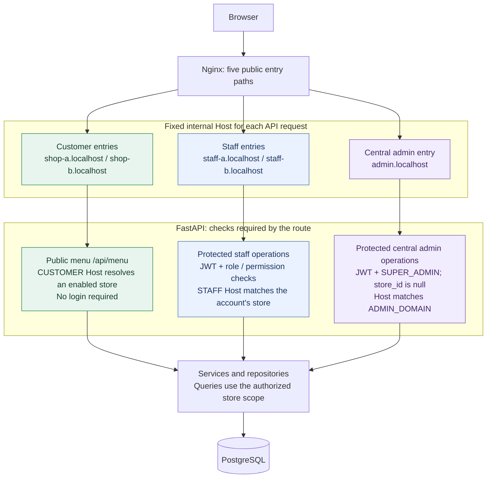
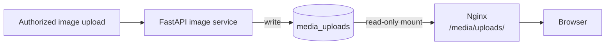
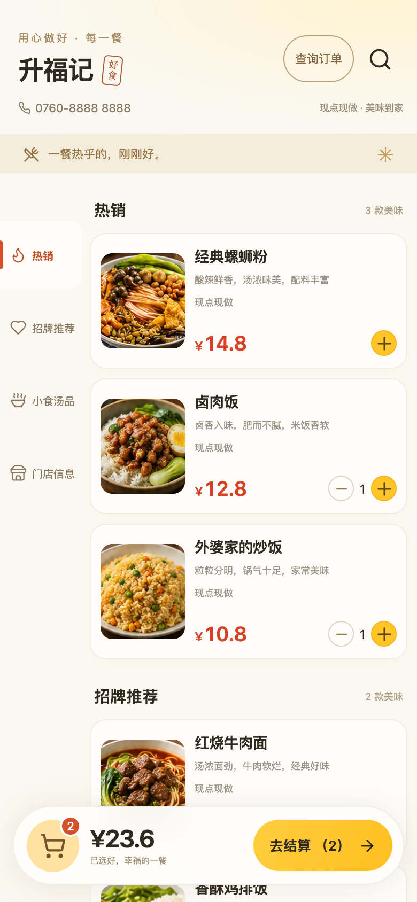
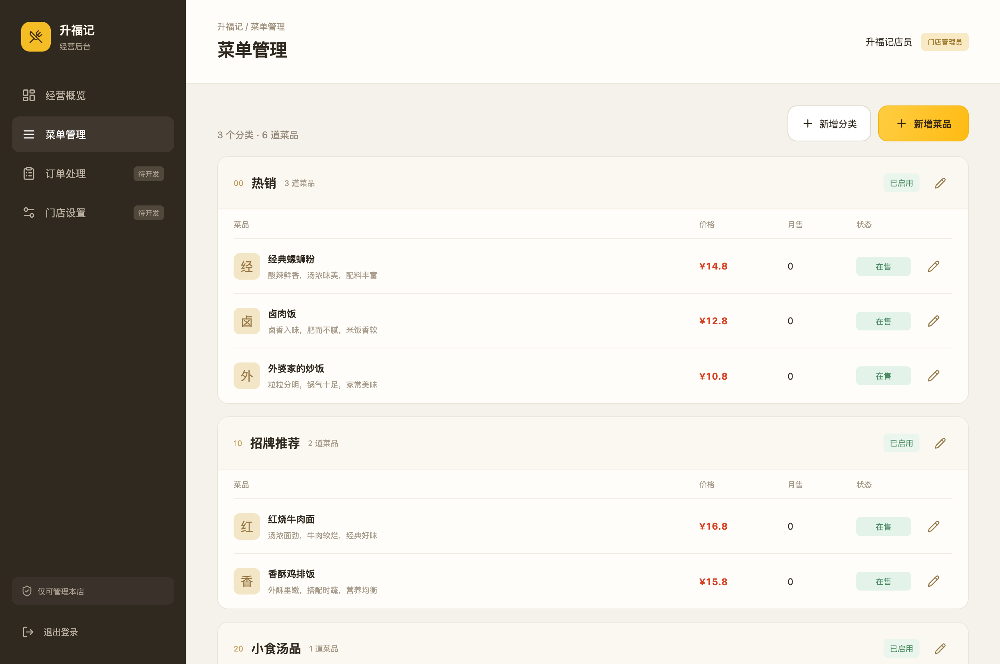
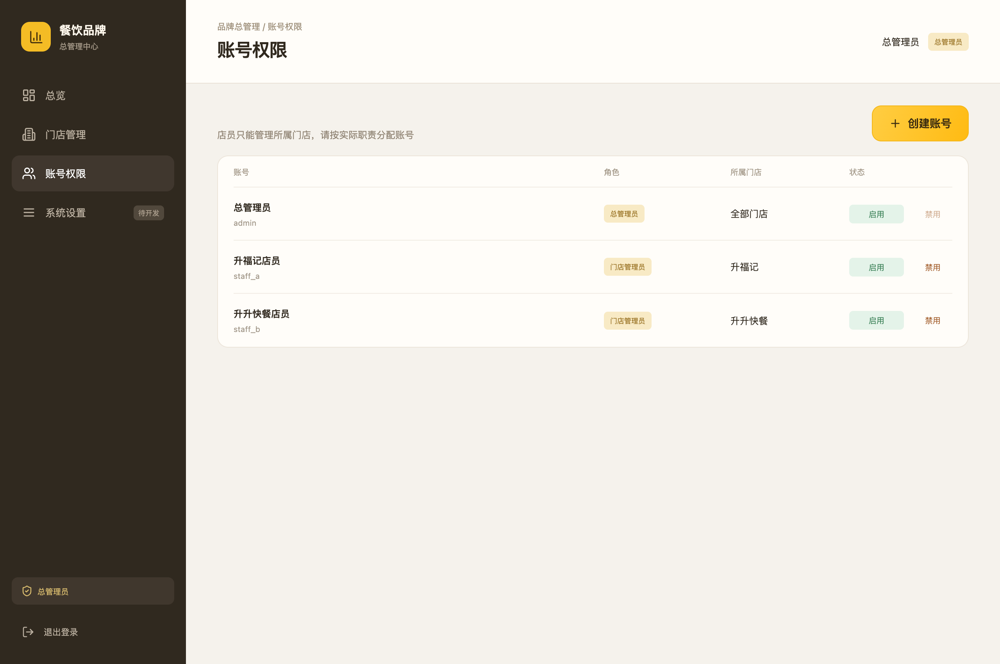

# Dual-Store Takeaway Ordering System

[中文文档](<README (中文).md>) · [Deployment guide](docs/DEPLOYMENT.md) · [中文部署指南](docs/DEPLOYMENT.zh-CN.md)

This repository contains a two-store ordering and operations system. The two stores share one FastAPI application, one PostgreSQL database, and one Nginx deployment, while menu records, staff accounts, members, delivery settings, and commerce records are scoped to a store.

The repository includes three Vue applications:

- a customer ordering interface;
- a store staff console for each store;
- a central administration console for cross-store configuration.

The current implementation includes menu management, member accounts, addresses, delivery-fee calculation, order state transitions, stock and coupon reservation, points and wallet ledgers, rewards, growth tasks, and audit events. The order and membership workflows are deliberately usable without claiming that money was collected: order and quote responses report `payment_status=UNPAID`, the capabilities endpoint reports `payment_enabled=false`, and revenue statistics expose `real_revenue_cents=0`.

## Project summary

This is a mobile-browser full-stack platform for two stores. One FastAPI service, one PostgreSQL database, and one Nginx deployment are shared while requests, menus, staff permissions, members, addresses, delivery settings, and commerce records remain scoped to the correct store. The central engineering problem is preserving those boundaries while reusing the same infrastructure.

The three product surfaces cover customer ordering, store operations, and central administration. Together with the backend, they demonstrate catalog management, member sessions, delivery-fee calculation, idempotent quotes and orders, stock and coupon reservation, points and wallet ledgers, rewards, growth tasks, audit records, Alembic migrations, and Docker Compose deployment. Payment remains an explicit boundary: the current implementation does not initiate, verify, refund, or reconcile a payment.

Built a multi-store ordering platform with fixed Nginx entry paths and backend store-context checks, covering customer ordering, store operations, central administration, member addresses, delivery fees, role-scoped JWT access, migrations, and containerized deployment.

## Review guide

This section gives a short path from a visible product behavior to the source file that implements it. It is useful when reviewing the repository without first reading every frontend component.

| Review question | Files to open | What can be verified |
| --- | --- | --- |
| How is each store selected? | `nginx/conf.d/takeaway.conf`, `backend/app/dependencies/store_context.py` | The public path is mapped to a fixed internal `Host`; the backend resolves a `StoreDomain` instead of trusting a caller-supplied `store_id`. |
| How are staff accounts restricted? | `backend/app/dependencies/auth.py`, `backend/app/utils/security.py`, `backend/app/routers/staff.py` | JWT identity, database permissions, staff-domain matching, and the super-admin domain check are enforced in backend dependencies. |
| How are order retries and inventory races handled? | `backend/app/services/commerce.py`, `backend/app/models/commerce.py`, `backend/tests/test_commerce.py` | The order payload is hashed, `(store_id, member_id, request_key)` is unique, stock is updated conditionally, and cancellation restores reserved stock and coupons. |
| How does the database evolve? | `backend/alembic/versions/`, `backend/alembic/env.py` | Four ordered revisions build the store, delivery, and commerce tables; the container applies `upgrade head` before serving requests. |
| How are the three user interfaces assembled? | `frontend-customer/`, `frontend-staff/`, `frontend-admin/`, `frontend-shared/`, `vite.config.js` | Three Vue entry points share typed API helpers and management components while producing separate static bundles. |
| What is intentionally outside the implementation? | `backend/tests/test_commerce.py`, `docs/DEPLOYMENT.md`, the [Known limitations](#known-limitations) section | Production configuration keeps payment disabled and documents the missing payment, routing, monitoring, and recovery integrations. |

## Verifiable behavior

The following behaviors are covered by source code and tests rather than being claims based only on the interface:

- A customer menu request remains bound to the host-selected store even if the request includes another `store_id`; an unknown host returns `404`.
- A Store A staff token cannot log in through or call the Store B staff domain; the backend returns `403` before the store-scoped operation runs.
- Repeating an order with the same `request_key` and payload returns the original order. Reusing the key with a changed payload is rejected, and the stock update is applied once.
- Cancelling a pending order returns reserved stock and makes its reserved coupon available again.
- A production order remains `UNPAID`; the capabilities response keeps `payment_enabled=false`, wallet payment is rejected, and revenue statistics remain `real_revenue_cents=0`.
- Uploaded menu images are bounded by file size and pixel count, reject animated or unsupported content, remove metadata, and are saved under a generated filename.

## Suggested review path

1. Start with the screenshots near the end of this document to identify the customer, store, and central-administration surfaces.
2. Open `nginx/conf.d/takeaway.conf` and `backend/app/dependencies/` to see how the five entry paths become backend store context and authorization decisions.
3. Read `backend/app/services/commerce.py` together with `backend/tests/test_commerce.py` to follow quote calculation, order creation, state transitions, and ledger updates.
4. Run the local setup below, then use the five URLs to inspect the built interfaces against the seeded data.
5. Read [Known limitations](#known-limitations) before describing the project as a production payment system.

## Project at a glance

| Item | Detail |
| --- | --- |
| Product scope | Customer ordering, store operations, and central administration for two stores |
| Main engineering problem | Reuse one service and database while keeping store data and staff actions inside the correct store boundary |
| Client stack | Vue 3, TypeScript, Vite, Pinia, and `lucide-vue-next` |
| Server stack | Python 3.12, FastAPI, SQLAlchemy 2 async sessions, Pydantic Settings, and Uvicorn |
| Persistence and deployment | PostgreSQL 16, Alembic, Docker Compose, Nginx, and named volumes for database/media |
| Validation recorded for this source set | 26 backend pytest cases, TypeScript checking, and three Vite production builds |

## Engineering highlights

- Store context is derived from Nginx's fixed internal host mapping and rechecked by FastAPI dependencies. Staff requests compare the authenticated account's `store_id` with the current staff domain before any store-scoped operation.
- Authorization is represented by database roles and permission codes. The backend checks `menu:read`, `menu:write`, `orders:read`, `orders:write`, `staff:manage`, `stores:manage`, and `cross_store:read`; the Vue clients do not act as the security boundary.
- Order totals are recalculated on the server from current menu, stock, options, delivery policy, and coupon state. `request_key` plus a payload hash makes retries safe, and stock/coupon updates occur in the same transaction as order creation.
- Delivery uses explicit coordinate-system conversion and a local Haversine calculation. It does not claim road distance or depend on a third-party map API.
- Uploaded images are bounded, decoded, metadata-stripped, resized, converted to WebP, and written with exclusive UUID filenames before they enter the shared media volume.
- Payment is intentionally represented as a disabled capability. The repository does not turn an operational order state into a paid or reconciled transaction.

## Current implementation scope

| Area | Current implementation |
| --- | --- |
| Customer ordering | Menu browsing, dish options, cart persistence, member login, addresses, quote, order creation, order history, cancellation |
| Store operations | Categories, dishes, prices, stock, publication state, sold-out state, images, delivery settings, orders, members, benefits, audit records |
| Central administration | Cross-store menu and delivery management, staff account creation and enable/disable, cross-store overview |
| Commerce rules | Server-side quote calculation, idempotent requests, stock and coupon reservation, role-scoped order transitions, member ledgers |
| Payment | Not connected; no initiation, notification, signature verification, query, refund, or settlement integration |
| Production operations | No production domain, HTTPS, monitoring, backup recovery, CI pipeline, or payment reconciliation configuration is included |

## Entry points and routing

Nginx exposes five public paths. It maps each path to a static Vue build and assigns an internal `Host` value to API requests. The browser never selects a store by sending an arbitrary `store_id` to the public menu endpoint.

| Public path | Client | Internal API host | Store scope |
| --- | --- | --- | --- |
| `/Adiandiancan/` | Customer | `shop-a.localhost` | Store A |
| `/Bdiandiancan/` | Customer | `shop-b.localhost` | Store B |
| `/Adianneibuguanli/` | Store staff | `staff-a.localhost` | Store A |
| `/Bdianneibuguanli/` | Store staff | `staff-b.localhost` | Store B |
| `/neibuguanli/` | Super administrator | `admin.localhost` | All stores |

The API is mounted under `/api` inside each path. The main route groups are:

| Prefix or route | Responsibility |
| --- | --- |
| `GET /api/health` | Executes `SELECT 1` through the SQLAlchemy session and reports database health |
| `GET /api/stores`, `GET /api/menu` | Enabled stores and public menu data for the host-resolved store |
| `/api/auth/*` | Staff and administrator login; returns a JWT access token |
| `/api/staff/*` | Store-scoped menu, image, and delivery-settings operations |
| `/api/admin/*` | Super-administrator store, menu, delivery, and staff-account operations |
| `/api/delivery/*` | Local delivery-place search, coordinate description, configuration, and delivery checks |
| `/api/commerce/*` | Member sessions, addresses, quotes, orders, benefits, ledgers, management operations, and statistics |

FastAPI's interactive documentation is at `/docs` only when `APP_ENV` is not `production`; the bundled Nginx configuration does not expose that path. Nginx returns `404` for a bare `/api` path so a caller cannot bypass the fixed store routing.

## Request path and store isolation (customer menu, staff, and central admin)

The diagram follows public menu requests and authenticated staff/admin operations. FastAPI selects the required dependencies for each route; public menu browsing does not require a login.



For example, a customer menu request follows three steps:

1. `/Adiandiancan/api/menu` reaches Nginx, which forwards `/api/menu` to FastAPI with the fixed `Host: shop-a.localhost`. Store B uses its own entry and `shop-b.localhost`.
2. `get_customer_store()` normalizes the host and resolves an enabled `StoreDomain` of type `CUSTOMER` and an enabled store. An unknown or disabled binding returns `404`.
3. The repository filters both `categories` and `dishes` by that store ID. Adding another `store_id` query parameter does not change the menu's store context.

Staff operations additionally load the enabled account from its JWT, check its role/permissions, and compare the staff domain's store with `AdminUser.store_id`; a cross-store mismatch returns `403`. Super-admin operations require `SUPER_ADMIN`, a null account `store_id`, and the configured `ADMIN_DOMAIN`. Their authorized scope can cover both stores. Login endpoints validate credentials before issuing a token.

Member-only customer operations, such as placing an order or reading saved addresses, add a store-bound `X-Member-Token` session check. This is separate from the staff/admin JWT mechanism. Store ownership and permissions are enforced by backend dependencies and database queries.

Uploaded images follow a separate file-serving path:



FastAPI writes processed images to `/app/media/uploads`. Nginx mounts the same volume read-only at `/usr/share/nginx/html/media/uploads` and serves the files directly. PostgreSQL and the backend have no published host ports in Compose.

## Roles and permissions

The seed routine creates five role codes and associates them with permission rows:

| Role | Store binding | Permission set |
| --- | --- | --- |
| `SUPER_ADMIN` | None; all stores | `menu:read`, `menu:write`, `orders:read`, `orders:write`, `staff:manage`, `stores:manage`, `cross_store:read` |
| `STORE_ADMIN` | Exactly one store | Menu read/write, order read/write, staff management |
| `ORDER_OPERATOR` | Exactly one store | Menu read, order read/write |
| `KITCHEN_OPERATOR` | Exactly one store | Menu read, order read/write; the commerce service limits the useful order transitions to kitchen states |
| `DELIVERY_OPERATOR` | Exactly one store | Menu read, order read/write; delivery transitions require a rider and a delivery order |

`/api/auth/login` uses Argon2 verification and issues a JWT signed with the configured algorithm, `HS256` by default. The token contains the user ID, issue time, expiry, and `type=admin_access`. The default access-token lifetime is 480 minutes. Production configuration rejects the development JWT secret and the default database credential.

Customer members use a separate session mechanism. Registration and login perform Argon2 password operations. A successful login creates a random 32-byte URL-safe token, stores only its digest, and returns the token to the client. A member session lasts 30 days; the account keeps at most 20 active sessions, and each session can be revoked independently. Members and addresses are always filtered by the current store ID.

Login protection exists at both layers. Nginx applies a 30 requests/minute limit to login and member-registration URIs. The commerce router also tracks attempts by client address and phone number, rejecting a key after 12 attempts within five minutes and cleaning old entries in memory.

## Data model and migrations

The SQLAlchemy models are grouped by responsibility:

- `stores`, `store_domains`: store identity, customer/staff domains, coordinates, radius, fee tiers, and enabled state;
- `roles`, `permissions`, `role_permissions`, `admin_users`: administrator identity and authorization;
- `categories`, `dishes`: store-owned menu data, price in cents, stock, publication, sold-out state, and optional dish groups;
- `commerce_members`, `commerce_sessions`, `commerce_addresses`: store members, device sessions, and saved addresses;
- `commerce_store_policies`, `commerce_dish_options`, `commerce_riders`: order policy, dish options, and delivery staff;
- `commerce_orders`: order header, item JSON, price breakdown, fulfillment mode, delivery snapshot, coupon claim, status, and event history;
- `commerce_ledgers`: points and wallet deltas with unique source keys;
- `commerce_coupons`, `commerce_coupon_claims`, `commerce_rewards`, `commerce_redemptions`, `commerce_tasks`, `commerce_audit_events`: benefits, rewards, growth tasks, and operational audit records.

The migration chain is:

1. `0001_stage1` — stores, domains, roles, permissions, admin users, categories, and dishes;
2. `0002_delivery_settings` — delivery coordinates and fee settings;
3. `0003_local_delivery_places` — saved delivery places;
4. `0004_test_commerce` — member and commerce tables.

The backend container runs `alembic upgrade head` before Uvicorn starts. The seed command is separate and is intended for an empty development database. `seed_initial_database()` checks for existing business rows and skips seeding instead of reintroducing deleted or renamed records.

Prices, packaging fees, delivery fees, discounts, totals, wallet balances, and lifetime spending are stored as integer cents. Database constraints and unique indexes enforce several invariants, including one member phone number per store, one order request key per member and store, non-negative balances, and non-negative order amounts.

## Commerce workflow

### Quote and order creation

`POST /api/commerce/orders/quote` recalculates the order from current database state. It validates:

- the dish belongs to the current store and is enabled, published, and not sold out;
- selected options are valid for the dish and their prices are included;
- requested quantity is within the schema limit and available stock is sufficient;
- the store policy permits the selected fulfillment mode;
- delivery orders have a valid address, a confirmed store location, a configured fee table, and a distance inside the delivery radius;
- the selected coupon belongs to the member and store, is active, and meets its minimum subtotal;
- the resulting total is below the configured amount limit.

`POST /api/commerce/orders` repeats the calculation inside the transaction. The client sends a `request_key` and the quoted total. The database has a unique `(store_id, member_id, request_key)` constraint. A repeated key with the same payload returns the original order; reusing it with different content is rejected. Stock is decremented with an atomic `UPDATE ... WHERE stock >= quantity`, and a coupon claim changes from `AVAILABLE` to `RESERVED` in the same transaction.

### Order states

```text
PENDING -> ACCEPTED -> PREPARING -> READY -> COMPLETED
                                      └─> DELIVERING -> COMPLETED
PENDING / ACCEPTED / PREPARING / READY / DELIVERING -> CANCELLED
```

The service checks the expected current state on every transition. A customer can cancel only a `PENDING` order. A delivery transition requires an enabled rider belonging to the same store and is valid only for delivery orders. When an order is cancelled, reserved stock is returned and a reserved coupon is made available again. When an order is completed, item sales are incremented, the coupon is marked used, and points are written to the member ledger. These completion actions are accounting records for the demo workflow; they are not proof of payment.

The management console also exposes member enable/disable, profile correction, points or wallet adjustment, coupon/reward/task configuration, redemption state changes, and audit-event listing. Manual adjustments use a request key and a ledger source key so a retried request does not apply the same balance change twice.

### Payment boundary

There is no payment provider adapter in this repository. The API exposes the payment boundary through separate response fields:

```text
order and quote responses: {"payment_status": "UNPAID"}
capabilities response:    {"payment_enabled": false}
statistics response:      {"real_revenue_cents": 0}
```

The planned payment work includes initiation, asynchronous notification, order query, signature verification, refund handling, callback idempotency, and reconciliation. Those operations should be added before describing this as a paid production ordering system.

## Delivery calculation

Delivery uses store-configured coordinates and fee tiers. The API accepts `GCJ_02`, `BD_09`, or `WGS_84` coordinates. `backend/app/utils/coordinates.py` converts inputs to WGS-84, using the local GCJ-02 formulas and the BD-09 conversion; the GCJ inverse uses iteration and fails closed if it does not converge.

The distance calculation is a spherical Haversine distance using the mean Earth radius `6371008.8` meters. It is a straight-line distance, not a road route. The service chooses the first configured fee tier whose `up_to_meters` contains the distance and rejects the order when the store location is unconfirmed, no fee tier exists, the coordinate conversion fails, or the point exceeds the configured radius. Address search is a local filter over the store's saved places; no map provider or map API key is required.

## Image upload pipeline

Menu images are processed by `backend/app/services/images.py`:

1. Read at most 5 MiB plus one byte to detect an oversized upload.
2. Accept only JPEG, PNG, or WebP.
3. Reject animated images, decompression bombs, and images above 20 million pixels.
4. Apply EXIF orientation and resize the longest edge to 2048 pixels.
5. Strip uploaded metadata by copying pixels into a new image and encode WebP at quality 85.
6. Save to the shared media volume with a UUID filename opened using exclusive creation.

Image decoding runs in a thread pool behind a two-slot semaphore so large image operations do not block the async event loop without a concurrency bound.

## Frontend build

The single Vite configuration builds each client by mode:

```bash
npm run build:customer
npm run build:staff
npm run build:admin
```

Each build uses `frontend-<mode>` as its root and writes to `nginx/html/<mode>`. `npm run build` first runs `vue-tsc --noEmit`, then builds all three clients. `base: './'` allows the same static bundle to be served below the five Nginx paths.

## Local setup

The [deployment guide](docs/DEPLOYMENT.md) covers first installation, configuration, verification, HTTPS, updates and backups. The following quick start uses the checked-in frontend bundles and a new local database.

### Create an independent instance

Install Git, OpenSSL, curl, and Docker Engine with a current Docker Compose v2 that supports `up --wait`. Python 3.12 runs inside the backend container. Node.js is only needed when rebuilding the frontend source.

```bash
git clone https://github.com/JackieHe12345/dual-store-takeout-ordering-system.git
cd dual-store-takeout-ordering-system
./scripts/bootstrap-env.sh
```

The bootstrap script creates a private `.env` with independent database, JWT and seed-account secrets, and refuses to overwrite an existing file. Edit these two settings in the generated `.env` for the local example:

```dotenv
NGINX_BIND_ADDRESS=127.0.0.1
NGINX_PORT=8080
```

The repository template defaults to `0.0.0.0:80`; the settings above bind this example to your own machine on port `8080`. Then start the stack and initialize the empty database:

```bash
docker compose config --quiet
docker compose up -d --build --wait
docker compose exec -T backend python -m app.seed
curl -fsS http://127.0.0.1:8080/Adiandiancan/api/health
```

Compose starts PostgreSQL, applies Alembic migrations before Uvicorn, and serves all three frontends through Nginx. It keeps database records in `postgres_data` and uploaded images in `media_uploads`. The seed command creates two demonstration stores, internal domain bindings, roles, accounts and menus only when the store, admin-user, category and dish tables are all empty. It skips an existing business database and does not reset account passwords.

| Interface | Local URL | Initial account |
| --- | --- | --- |
| Store A customer | [Open Store A](http://127.0.0.1:8080/Adiandiancan/) | Public menu; register a store member to order |
| Store B customer | [Open Store B](http://127.0.0.1:8080/Bdiandiancan/) | Public menu; register a store member to order |
| Store A staff | [Open Store A console](http://127.0.0.1:8080/Adianneibuguanli/) | `staff_a` |
| Store B staff | [Open Store B console](http://127.0.0.1:8080/Bdianneibuguanli/) | `staff_b` |
| Central administration | [Open admin console](http://127.0.0.1:8080/neibuguanli/) | `admin` |

Retrieve the three initial passwords from the corresponding `SEED_*_PASSWORD` values in your local `.env`. Replace the demonstration menus, coordinates, delivery fees and staff configuration through the management interfaces. The [Chinese deployment guide](docs/DEPLOYMENT.zh-CN.md) describes the same setup.

### Rebuild the frontend when changing source

Use Node.js `^20.19.0 || >=22.12.0`, as required by the locked Vite packages:

```bash
npm ci
npm run build
```

This checks TypeScript and rebuilds all three clients into `nginx/html/`. Direct deployment of the committed bundles does not require this step. For local backend tests, install Python 3.12 or newer and use the isolated environment below.

## Tests and verification

Run the backend tests in an isolated environment:

```bash
cd backend
python -m venv .venv
. .venv/bin/activate
pip install -e '.[dev]'
pytest
```

The tests use SQLite fixtures through `aiosqlite` and cover the stage-one API, migration from revision `0003`, seed behavior, menu and staff permissions, cross-store access, member sessions, addresses, orders, stock and coupon reservation, order transitions, delivery checks, ledgers, rewards, tasks, and production payment gates. The recorded validation for this source set contains 26 passing backend test cases; `npm run build` validates TypeScript and all three Vite production builds.

## Repository layout

```text
backend/
  app/
    dependencies/     authentication and store-context dependencies
    models/            SQLAlchemy models
    repositories/      store and catalog queries
    routers/           HTTP route groups
    schemas/           Pydantic request/response models
    services/          catalog, commerce, delivery, and image services
    utils/             password/JWT and coordinate utilities
  alembic/             migration environment and revisions
  tests/               async API, migration, seed, and authorization tests
frontend-customer/     customer application
frontend-staff/        store staff application
frontend-admin/        central administration application
frontend-shared/       shared Vue components, API helpers, types, and styles
nginx/
  conf.d/              five-path reverse proxy configuration
  html/                built static assets and seed menu images
scripts/               environment bootstrap, backup, and verification helpers
docs/
  DEPLOYMENT.md        English deployment guide
  DEPLOYMENT.zh-CN.md  Chinese deployment guide
  screenshots/         interface screenshots
compose.yaml           PostgreSQL, backend, and Nginx services
```

## Known limitations

The following work is outside the current implementation:

1. Payment initiation, notification, query, signature verification, refunds, callback idempotency, and financial reconciliation.
2. Linking fulfillment transitions to verified payment and refund results.
3. Road-distance routing, geocoding, and live rider dispatch; delivery currently uses saved places and straight-line distance.
4. Production domain and HTTPS configuration, centralized logs, metrics, alerting, backup recovery drills, and CI.

The order state machine, member ledgers, coupons, rewards, and tasks are implemented as application workflows. They should not be represented as proof that a customer was charged.

## Screenshots

These images are committed repository assets from the three built interfaces. A local instance started with the setup steps above exposes the same surfaces at the five paths listed in [Entry points and routing](#entry-points-and-routing).







## License and repository safety

This project is released under the MIT License. The public repository should contain source code, migrations, tests, placeholder configuration, built demo assets, screenshots, and generic deployment notes only. Keep real passwords, JWT secrets, database URLs, payment certificates, SSH keys, server addresses, backups, logs, and customer data outside Git.
